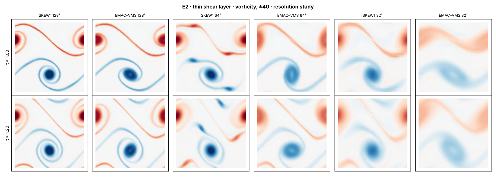
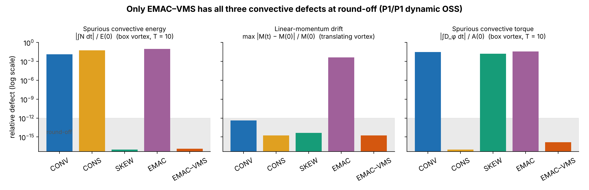
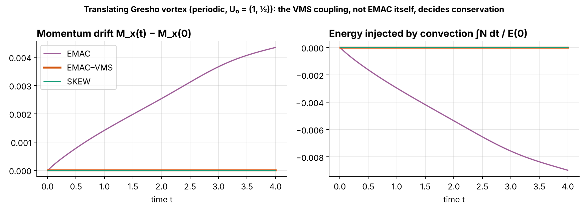

# navier-stokes-vms

Variational multiscale (VMS) finite element solvers for the incompressible Navier–Stokes
equations, built on [Firedrake](https://www.firedrakeproject.org). The code runs in 2D and 3D,
in serial or with MPI, and includes a new energy-, momentum- and angular-momentum-conserving
convective form, **EMAC–VMS**.

<p align="center">
  
  <br><em>Vorticity of a thin double shear layer: skew-symmetric (SKEW1) and EMAC–VMS
  at 128², 64² and 32².</em>
</p>

## Method

The velocity and pressure are split into a finite element part and an unresolved subscale,
$u = u_h + \tilde u$ and $p = p_h + \tilde p$. The subscale is modelled from the residual of
the resolved equations, $R_u = f - \partial_t u_h - (a\cdot\nabla)u_h + \nu\Delta u_h - \nabla p_h$,
as an ODE at each quadrature point:

$$
\partial_t \tilde u + \tau_m^{-1}\,\tilde u = P(R_u), \qquad
\tau_m = \left(\frac{c_1\nu}{h^2} + \frac{c_2|a|}{h}\right)^{-1}, \qquad
\tilde p = -\tau_c\,\nabla\cdot u_h .
$$

Feeding $\tilde u$ back into the Galerkin equations stabilizes equal-order elements (P1/P1) and
convection-dominated flow. All eight classical variants are implemented:

| Choice | Options |
| --- | --- |
| Subscale space $P$ | ASGS (identity) or OSS (orthogonal to the FE space) |
| Subscale dynamics | static or dynamic (time-dependent $\tilde u$) |
| Scale splitting | linear ($a = u_h$) or nonlinear ($a = u_h + \tilde u$) |

The convective term can take six forms: nonconservative, conservative, two skew-symmetric
forms, EMAC and **EMAC–VMS**. EMAC–VMS writes the effect of the subscales as a symmetric
subgrid stress

$$
\tilde T = \tilde u \otimes u_h + u_h \otimes \tilde u + \tilde u \otimes \tilde u ,
$$

tested against $\nabla^s v_h$. Because $\nabla^s$ of a rigid motion is zero, the subscales
cannot create a spurious force or torque. The energy transfer $\tilde T : \nabla^s u_h$ cancels
exactly with the subscale residual. As a result, energy, linear momentum and angular momentum
are all conserved by convection. Time stepping uses BDF1–3 or Crank–Nicolson, solved with
Newton or Picard iterations.

## Results

Of the five forms, only EMAC–VMS keeps all three convective defects at round-off:



Standard EMAC loses momentum and energy as soon as subscales are present. The VMS coupling,
not EMAC itself, decides conservation:



[`FINDINGS.md`](https://github.com/AOKabalan/VMS_NS/blob/experiment/emac-vms-advantage/experiments/emac_vms_advantage/FINDINGS.md) (on the `experiment/emac-vms-advantage` branch)
has the full set of experiments, including the cases where EMAC–VMS is *not* better: it is
more dissipative at every resolution tested, most visibly on coarse meshes (vorticity panel above).

Validation against published data: lid-driven cavity (Ghia et al. 1982, Re = 100 and 1000),
flow past a cylinder (DFG 2D-2), lattice vortex and Ethier–Steinman 3D (exact solutions), and
the Gresho vortex.

## Quick start

Install Firedrake first (tested with 2026.10.0), then, inside its virtual environment:

```bash
pip install -e ".[dev]"
python scripts/run_simulation.py configs/<file>.toml            # serial
mpiexec -n 4 python scripts/run_simulation.py configs/<file>.toml
pytest tests/unit
```

Each run is described by one TOML file and writes its fields, diagnostics and provenance to
`results/<case>/<run_name>/`.

## Documentation

- [`docs/usage.md`](docs/usage.md): configuration, diagnostics, validation and conservation runs
- [`docs/formulation_spec.md`](docs/formulation_spec.md): every equation implemented
- [`docs/implementation_plan.md`](docs/implementation_plan.md): code structure and tests
