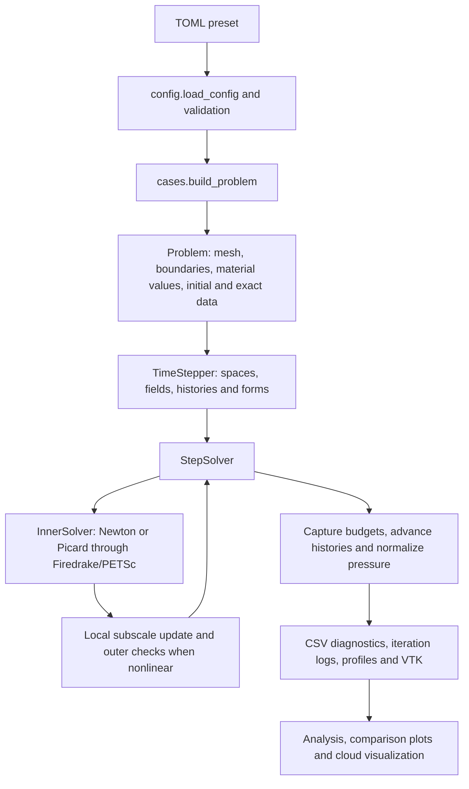

# Repository map and implementation inventory

Inspected 11 November 2026, at tracked revision `52c074f`. This is a map of
the current source and local workspace, including ignored research artifacts.
Historical reports are evidence of their recorded runs, not claims that every
experiment has been repeated at this revision.

## What this project is

`navier-stokes-vms` is a Python research package for finite-element simulation
of incompressible viscous flow, using Firedrake, UFL and PETSc. Its central
subject is residual-based variational multiscale (VMS) stabilization, including
orthogonal subscales and the conservation properties of different convection
forms. A coupled thermal Boussinesq extension adds temperature-driven buoyancy
and optional passive scalars. Kelvin–Helmholtz and internal-gravity-wave cases
use that extension to produce idealized moist-layer visualizations.

There are three substantial layers: the reusable solver under `src/`, the
versioned configurations/tests/reports, and a local research archive under
`results/` containing numerical outputs **and additional executable code**.

Current inventory:

| Item | Count or size |
| --- | --- |
| Package Python source | 46 files, 6,845 lines |
| Python entry points and analysis scripts in `scripts/` | 11 files, 2,533 lines, plus a shell queue |
| Python tests and helpers | 46 files, 9,269 lines |
| Collected parameterized tests | 1,092: 1,023 unit, 69 verification |
| Registered physical/verification cases | 14 |
| Committed TOML presets | 152 |
| Local `results/` | About 8.8 GB, including 6.6 GB of compiler cache |
| Local reference data | About 125 MB |
| Documentation and media | About 31 MB |

Line counts exclude bytecode and installed package metadata. Sizes use `du -sh`
and describe allocated local storage. Test cases include parameter expansions.

## Directory map

```text
VMS_NS/
├── README.md                    Project introduction and animated demos
├── pyproject.toml               Package metadata, dependencies, pytest/Ruff settings
├── src/navier_stokes_vms/       Reusable implementation
│   ├── config.py               Typed TOML options and validation
│   ├── cases/                  14 builders and registry
│   ├── problem/                Physical data, meshes, boundary descriptions
│   ├── discretization/         Spaces, quadrature, time coefficients
│   ├── formulation/            UFL residual and projection kernels
│   ├── solver/                 Assembly, nonlinear solves, histories, time loop
│   └── postprocessing/         Diagnostics, budgets, profiles, output, cloud kernels
├── configs/
│   ├── validation/             Cavity, cylinder and lattice-vortex comparisons
│   ├── chapter5/conservation/  Gresho and Taylor–Green convection studies
│   └── boussinesq/             Thermal MMS, cavities, channels, KH and gravity waves
│       └── kh_growth/          Larger proposed growth-study matrix
├── scripts/                    Run, analyze, plot and visualize commands
├── tests/
│   ├── unit/                   Numerical identities and behavior regressions
│   ├── verification/           Spatial/time refinement and parallel comparisons
│   └── data/                   Small named-boundary Gmsh fixture
├── meshes/                     DFG cylinder geometry and four mesh levels
├── data/references/            Literature/benchmark comparison inputs
├── docs/                       Formulations, plans, reviews, measured reports, media
├── results/                    Ignored local outputs, studies, drivers and slides
├── experiments/                Currently only residual Python bytecode
└── beamerthemeinterviewmaths.sty  Local, untracked Beamer theme
```

`.pytest_cache`, `.ruff_cache`, `__pycache__` and `src/*.egg-info` are generated
working artifacts. The `.agents`, `.codex` and `.aws` directories are not part
of the numerical package. No applicable `AGENTS.md` was found in this repo or
its ancestor directories during inspection.

## Mathematical and numerical capabilities

### Isothermal flow

The resolved unknowns are velocity and pressure. The Galerkin equations express
momentum balance and incompressibility, with prescribed forcing, initial data
and boundary data. Two viscosity forms are available: the vector Laplacian
and symmetric stress. VMS models unresolved velocity and optionally unresolved
pressure from the resolved residual.

The eight VMS choices are the Cartesian product of:

| Switch | Meaning |
| --- | --- |
| ASGS / OSS | Use the residual directly / subtract a weighted FE projection |
| Static / dynamic | Algebraic subscale / time-dependent subscale with stored histories |
| Linear / nonlinear splitting | Advector is resolved velocity / resolved plus iterated subscale velocity |

The actual stabilization parameter is more specific than the README's shorthand:

```text
h     = minimum cell edge length
tau_m = 1 / (c1*k^4*nu/h^2 + c2*k*|a|/h)
tau_c = h^2 / (c1*k^4*tau_m)
tau_t = 1 / (alpha0/dt + 1/tau_m)       for dynamic subscales
```

Here `k` is velocity polynomial degree. The default integration degree is
`3*k`; quadrature weights must be positive, and the same point rule supplies
quadrature-space subscale storage. These details matter to the weighted
orthogonality and dissipation arguments.

Six convection forms are implemented: `nonconservative`, `conservative`,
`skew_symmetric_1`, `skew_symmetric_2`, `emac`, and `emac_vms`.
EMAC–VMS uses the symmetric subgrid stress
`s⊗u + u⊗s + chi_N*s⊗s`, paired with the symmetric test gradient. Its
conservation identities do not imply constant total energy in viscous,
stabilized, time-discrete simulations or with boundary work.

The EMAC pressure unknown is modified pressure `P`; the code reports physical
pressure `p = P + |u|^2/2`. Closed problems carry a constant-pressure null space
and use a spatial zero-mean gauge. Problems with outflow omit that null space.

### Coupled temperature and passive scalars

`Problem.thermal` selects thermal physics. Temperature obeys advection–diffusion
with sources and independent thermal boundary data. Buoyancy acceleration is
`-beta*(T-T_ref)*g`. Passive scalars have their own diffusivities, sources and
boundary conditions; they require a thermal problem and do not drive buoyancy.

The thermal system includes Galerkin and all eight VMS variants, including
temperature-subscale feedback in momentum. Velocity, pressure, temperature,
passive scalars and OSS projections are composed into a monolithic mixed
residual. Scalar convection can be skew-symmetric, nonconservative or
conservative.

Current enforced restrictions:

- Galerkin uses Taylor–Hood degrees, `k_u = k_p + 1`; VMS uses equal orders.
- Thermal temperature degree equals velocity degree; transported scalar spaces
  use that same degree.
- Thermal momentum supports only `skew_symmetric_1` or `nonconservative`, with
  Laplacian viscosity and closed/periodic velocity boundaries. Thermal EMAC,
  stress viscosity and outflow are not supported.
- EMAC and EMAC–VMS require Newton and prohibit Picard warm-up. EMAC–VMS also
  requires VMS and stress viscosity.
- Free slip constrains a homogeneous axis-aligned normal component. Tilted-wall
  free slip is rejected.
- Thermal budgets have admissibility conditions on boundaries and test fields.
  Thermal momentum budgets remain future B6 work.

### Time and nonlinear solution

BDF1, BDF2, BDF3 and Crank–Nicolson use uniform steps; final time must be a whole
number of steps. Startup uses lower-order schemes or exact resolved histories
when every required exact field is available. Subscale histories start at zero;
arbitrary subscale startup is not a claim of full high-order accuracy.

The inner solve is Newton or Picard, optionally starting Newton with Picard
iterations. Stabilization coefficients can be frozen in the Jacobian or
differentiated exactly. Nonlinear scale splitting adds an outer fixed point
with local quadrature-point subscale updates. These can use direct fixed-point
or accelerated updates. Convergence includes the actual FE residual and,
where applicable, field/projection changes and subscale closure checks.

Default linear algebra is PETSc `preonly` + LU + MUMPS. MPI support exists,
but that default is a direct solver, not evidence of scalable iterative
preconditioning. Exact differentiation of `|a|` at rest is a documented
limitation; static nonlinear subscale updates can also become nearly singular
on coarse meshes. A near-inviscid nonlinear ASGS Gresho case is retained as a
strict expected failure.

## How a simulation flows through the code



`scripts/run_simulation.py` owns the command-line lifecycle and provenance.
`TimeStepper` is the main integration point: it constructs spaces and forms,
initializes fields, advances time, captures diagnostics and writes output.
It is the largest package file, at 926 lines. It builds isothermal forms
through a local composition function and delegates thermal composition to
`system_builder.thermal_system`.

The main source responsibilities are:

| Source | Responsibility |
| --- | --- |
| `config.py` | Frozen option dataclasses, strict TOML keys/types, defaults and option compatibility |
| `problem/problem_definition.py` | Shared `Problem`, forcing from exact fields, boundary/exact-field checks |
| `problem/thermal_problem.py`, `scalar_problem.py` | Thermal/passive physical data and supported combinations |
| `problem/mesh_loading.py`, `boundary_conditions.py` | Builtin/Gmsh meshes, named tags, Dirichlet, outflow, flux and slip conditions |
| `discretization/function_spaces.py` | CG mixed spaces, named `FieldLayout`, OSS projection spaces, pressure basis |
| `discretization/time_schemes.py`, `quadrature.py` | Coefficients/startup and common integration rules |
| `formulation/galerkin.py`, `operators.py` | Base weak residual, derivatives and strong residual operators |
| `formulation/vms.py`, `oss_projections.py` | Eliminated subscales, feedback and weighted projection equations |
| `formulation/convective_forms.py` | Six convection forms, EMAC stress, pressure conversion and predicted defects |
| `formulation/thermal.py`, `boussinesq.py` | Scalar kernels and buoyancy |
| `solver/nonlinear_solver.py` | Inner/outer convergence, iteration records and failure reasons |
| `solver/field_history.py`, `subscale_storage.py` | Resolved/subscale history rotation and CN endpoint recovery |
| `solver/reusable_assembly.py` | Preprocessed Firedrake assemblers used repeatedly with mutable state |
| `postprocessing/diagnostics.py` | Registry, norms, forces, moments and isothermal conservation budgets |
| `postprocessing/thermal_budgets.py` | Discrete content, variance, energy and wall-reaction accounting |
| `postprocessing/horizontal_profiles.py` | Collective horizontal means and optional Fourier coefficients |
| `postprocessing/output.py`, `run_logging.py` | VTK, CSV, JSON provenance and rank-zero logs |
| `postprocessing/cloud_visualization.py` | Affine P1/P2 triangle interpolation, derivatives and cloud integrals |

## Cases and presets

Each case implements `build(config) -> Problem` and is registered in
`cases/__init__.py`. Parameters belong to the case; numerical switches belong
to `Config`.

| Registered case | Role | Presets |
| --- | --- | ---: |
| `manufactured_spatial` | Isolate spatial error with time-linear exact velocity | 0 |
| `manufactured_temporal` | Representable rotation to isolate temporal error | 0 |
| `kovasznay` | Steady exact flow and convergence/linearization studies | 0 |
| `taylor_green_2d` | Periodic decaying exact vortex and conservation studies | 24 |
| `ethier_steinman_3d` | Three-dimensional exact flow and MPI verification | 0 |
| `gresho` | Compact vortex, moments, energy and dissipation studies | 31 |
| `lid_driven_cavity` | Ghia centerline profiles and steady-flow comparison | 7 |
| `cylinder_dfg_2d` | DFG Re=100 flow, force/pressure comparisons and outlet checks | 7 |
| `lattice_vortex` | Vortex decay validation | 2 |
| `manufactured_boussinesq` | Coupled exact velocity/pressure/temperature checks | 9 |
| `differentially_heated_cavity` | Square natural-convection validation and tall-cavity pilots | 5 |
| `free_slip_channel` | Boundary constraints, uniform preservation and thermal checks | 2 |
| `kelvin_helmholtz_shear_layer` | Stratified shear, startup, mode growth, optional moisture | 63 |
| `internal_gravity_wave` | Stable standing waves and moist-layer ripples | 2 |

Zero presets means the case is built by tests or local drivers, not that the
case is absent. Gresho's exact fields are an Euler reference; at positive
viscosity they are not an exact solution of the unforced viscous equations.

KH uses wall-compatible tanh-based profiles, hydrostatic pressure
initialization, periodic horizontal geometry, free-slip walls, optional seeded
noise, optional vertical clustering, and mean/Fourier outputs. Its FE initial
state need not be exactly hydrostatic or divergence-free. The gravity-wave
case instead has a stable linear temperature background, no mean shear,
fixed-temperature walls and an unforced standing-wave kick.

## Commands and outputs

| Script | Purpose |
| --- | --- |
| `run_simulation.py` | Run one TOML configuration |
| `run_validation.py` | Run/analyze the three classical validation cases; supports short smoke runs |
| `run_validation_queue.sh` | Sequential, resumable queue with cost ordering, simulation/validation runners and dry-run |
| `run_convergence_study.py` | Sweep mesh cells or step counts and calculate error rates |
| `generate_conservation_configs.py` | Regenerate the 55 Chapter 5 presets |
| `analyse_conservation.py` | Absolute/scaled defects, budgets, drifts and long-Gresho plots |
| `analyse_kh_startup.py` | Compare completed matched control/seeded runs |
| `analyse_kh_growth.py` | Fit Fourier-mode growth in an explicit time window |
| `analyse_gravity_wave.py` | Measure wave period, displacement modes and overturning indicators |
| `plot_boussinesq_verification.py` | Plot committed convergence measurements without solving |
| `visualize_clouds.py` | Gather saved VTK fields, compute cloud proxy, export frames/VTK/GIF/MP4/CSV |
| `visualize_kh_clouds.py` | Compatibility wrapper for the common cloud visualizer |

The standard run directory is `results/<case>/<run_name>/`. Existing
directories are refused. A run records `config_resolved.toml`, `run_info.json`,
`run.log`, `initial_state.json`, `diagnostics.csv`, `inner_iterations.csv`,
`outer_iterations.csv` and `time_steps.csv`. Thermal runs add
`thermal_metadata.json`; optional profiles add CSV/JSON; optional fields live
in `fields/` as separate velocity, pressure, temperature and scalar VTK series.

Velocity/scalar values are endpoint fields. Pressure is at the solve time,
which differs for CN; diagnostics explicitly record field times. Provenance
includes commit/dirty status, software versions, MPI size, host, timestamps,
wall time and exit status. Failed nonlinear steps write their last solve state
and iteration history. **VTK output is not a restart checkpoint**: the solver
does not persist the complete histories needed to resume a time integration.
Queue resumability means skipping terminal records, not restarting fields.

## Local archive and references

`results/` is ignored by Git. Its current grouped layout is documented in
[results_layout.md](results_layout.md), with a local index in
[`results/README.md`](../results/README.md). The spelling `bousinesq` is
intentional, as recorded in that layout document.

| Directory | Local contents | Size |
| --- | --- | ---: |
| `results/navier_stokes/` | Cavity/cylinder/lattice runs, Gresho, Taylor–Green, unstratified KH | 731 MB |
| `results/bousinesq/` | Thermal cases, convergence evidence and two cloud-pilot families | 1.2 GB |
| `results/analysis/` | Conservation, Kovasznay, dissipation, causal audits and KH solver profiling | 392 MB |
| `results/presentation/` | Plot generators, numerical tables, Beamer frames, PDFs and verification records | 12 MB |
| `results/reports/` | `VMS_NS_COMBINED_RESULTS_REPORT.pdf` | 16 MB |
| `results/logs/` | Historical queues, completion/PID/lock records and backed-up scripts | 24 MB |
| `results/.b0-test-cache/` | Firedrake/compiler caches | 6.6 GB |

Old case paths are compatibility symlinks into these groups; they are not
duplicate simulations. All top-level results symlinks resolved at inspection.
The relocation manifest records prior moves and hashes. PID/lock files alone
are not evidence of an active process.

A scan of `run_info.json` files in the three major groups found:

| Group | Exit status 0 | Nonzero exit status | No terminal status |
| --- | ---: | ---: | ---: |
| `navier_stokes` | 101 | 0 | 6 |
| `bousinesq` | 72 | 2 | 0 |
| `analysis` | 152 | 4 | 0 |

These 337 metadata records are not 337 independent accepted scientific
results: they include probes, overlapping study prefixes, and completed
simulations that reports subsequently rejected scientifically. The scan does
not classify directories that have no `run_info.json`.

There are 38 Python files inside `results/`, including 23 under `analysis/`.
Particularly useful local study entry points include:

- `analysis/conservation_analysis/kovasznay_convergence/`: matched SKEW1 and
  EMAC–VMS exact-flow refinement, protocols, drivers and reports.
- `analysis/conservation_analysis/kovasznay_all_forms/`: seven-label Re=40/400
  comparison, tables and scripts; see the variant mismatch below.
- `analysis/conservation_analysis/kovasznay_mechanism_audit/`: pressure,
  quadrature and independent-assembly controls for the error ranking.
- `analysis/conservation_analysis/gresho_dissipation_experiment/`: six
  completed runs, dissipation maps, regional accounting and Gram decompositions.
- `analysis/conservation_analysis/gresho_emac_skew_cause/` and
  `existing_transient_audit/`: mechanism and earlier-transient analyses.
- `analysis/kh_lu_assessment/`, `kh_block_profile/`, `kh_phase_profile/`:
  LU reuse, profiling, coordinate-matched accuracy checks and solver trials.

The recorded comparisons do not establish a universal EMAC–VMS accuracy
advantage: matched local Kovasznay studies favor classical forms in velocity
error; Gresho reports show smaller losses/errors with higher degree and lower
losses for SKEW1 on their tested meshes. Conservation and pointwise accuracy
are separate evaluation criteria.

Reference inputs under `data/references/` include Ghia cavity profiles, DFG
cylinder benchmark records/archives, lattice decay, and a pinned unstratified
KH dataset. The latter contains a committed upstream tarball and an ignored
unpacked copy, with a manifest. That hydrodynamic KH dataset uses different
profiles/scaling and does not validate thermal coupling in the stratified case.
`docs/papers/` holds local reading PDFs; their presence is separate from the
versioned solver and reports.

## Evidence, validation limits and reproducibility gaps

The strongest evidence is a combination of independent kernel identities,
solved discrete budgets, refinement tests, reference comparisons and MPI
agreement. `tests/unit` contains real FE solves as well as small algebra and
configuration checks; its name does not imply every case is cheap. The six
verification test modules contain 69 parameterized cases.

| Area | Recorded evidence and present limit |
| --- | --- |
| Core VMS/convection | Residual expansions, Jacobians, projection orthogonality, dissipation and solved energy/momentum balances; known rest/exact-tau and near-inviscid ASGS limits remain |
| Boussinesq core | All-variant discrete budget matrices; representative P1/P2 spatial and four-scheme temporal refinement, plus serial/two-rank checks |
| Square heated cavity | Recorded Nu refinement at Ra=1,000/10,000; separate volume, variational-reaction and gradient flux estimates |
| Tall heated cavity | Short integration checks only; no validated long-time oscillations or chaos |
| Free-slip channels | Component constraints, gauge, uniform preservation, shear diffusion and thermal budget tests |
| Stratified KH | Startup controls and finite-window modal growth; full Ri/Re/stabilization matrix remains unlaunched |
| KH cloud pilot | Completed four-billow visualization; strongest cloud signal depends on moisture overshoot |
| Gravity-wave pilot | Accepted P2 run has about 0.24% period error and no sampled overturning; full convergence and atmospheric calibration remain absent |

The KH 20–30 growth window has about 0.38% mesh sensitivity and 0.0010%
timestep sensitivity, but 2.45–2.73% half-window drift, exceeding the proposed
2% target. A later predeclared subwindow performs better. Reports therefore
describe a finite-window rate, not a unique asymptotic eigenvalue.

The cloud indicator is a postprocessed positive moisture excess over a
saturation proxy. Moisture is passive: there is no condensation feedback,
latent heating, ice microphysics or full atmospheric cloud model. Gravity-wave
pilots also retain small tracer-bound errors; successful nonlinear convergence
does not establish tracer boundedness or physical cloud morphology.

Specific repository gaps found during inspection:

1. **Some local research code is outside version control.** A fresh clone does
   not include `results/` drivers, the presentation pipeline or raw results.
2. **The local seven-form comparison exceeds the current core interface.**
   `kovasznay_all_forms/study.py` lists `emac_vms_full` and its driver passes
   that label onward. The current TOML type and convection/pressure kernels
   implement only six forms. Programmatic `validate_config` does not reject
   that label, but the downstream kernel dictionaries do not support it.
   Existing full-variant artifacts need their matching implementation/revision
   before that branch can be reproduced. This is not a seventh current feature.
3. **Experiment source is missing from `experiments/`.** Its KH subfolder now
   contains only two `.pyc` files; some archived narratives/drivers reference
   experiment paths that are not present in this checkout. Archived results
   remain useful evidence but are not all executable recipes.
4. **Historical counts/status are not a current index.** The test-suite review
   records 1,083 cases before later additions; current collection is 1,092.
   Old planning statements can predate completed pilots. Use dated measured
   reports and current code together.
5. **Environment reproduction is partly external.** Python >=3.11 is declared;
   the tested Firedrake/PETSc stack is documented but not provisioned or locked
   by this repo. There is no tracked CI workflow, lockfile, container definition
   or license file. Cloud rendering also uses VTK, Pillow and external ffmpeg,
   beyond the two direct runtime dependencies in `pyproject.toml`.

The current source is organized around relatively small UFL kernels and named
physical data, with substantial integration complexity concentrated in
`TimeStepper`, nonlinear iteration and budget diagnostics. Those are the main
places where changes can affect multiple methods at once.

## Suggested reading routes

- To understand the science: [formulation_spec.md](formulation_spec.md), then
  [boussinesq_formulation.md](boussinesq_formulation.md) and
  [gravity_wave_formulation.md](gravity_wave_formulation.md).
- To operate it: [usage.md](usage.md), a matching TOML preset, then
  `scripts/run_simulation.py` and `cases/__init__.py`.
- To change solver behavior: `solver/time_stepper.py`,
  `solver/nonlinear_solver.py`, the relevant formulation kernel and tests.
- To assess evidence: [B5](verification/boussinesq_b5.md),
  [KH refinement](verification/kelvin_helmholtz_b73_refinement.md),
  [KH cloud pilot](verification/kelvin_helmholtz_cloud_pilot.md), and
  [gravity-wave pilot](verification/gravity_wave_cloud_pilot.md).
- To understand history: [progress_log.md](progress_log.md), the implementation
  plans and review files. The large `verification/VERIFICATION.md` is a
  historical equation/specification review, not a concise current status page.
- To locate local numerical studies: `results/README.md`, the study-specific
  protocols under `results/analysis/`, and `results/presentation/README*.md`.

## Checks performed for this map

- Inspected all package modules structurally, traced the simulation/solve/output
  path, and read the central implementation, current reports and local study
  drivers. Inventoried results metadata without rerunning archived studies.
- Loaded all 152 committed configuration files successfully.
- Collected all 1,092 tests using the installed Firedrake environment.
- Ran configuration, time-scheme and cloud-visualization modules: **119 passed
  in 35.54 seconds**.
- Reran all six Boussinesq convergence tests: **6 passed in 187.49 seconds**,
  covering representative P1/P2 spatial refinement and four time schemes.
- Full unit-suite, all-method convergence and MPI execution were not rerun for
  this repository review. Historical suite passes remain historical evidence.

The installed environment is `/home/ali/venv-firedrake`: Python 3.14.4,
Firedrake 2026.10.0, petsc4py 3.26.0, NumPy 2.4.6 and pytest 9.1.0.
Fresh check logs are in `/tmp/vms_repo_map_collection.log` and
`/tmp/vms_repo_map_checks.log`, with convergence results in
`/tmp/vms_repo_map_convergence.log`. The sandbox emitted MPI interface-discovery
warnings; collection and the focused tests still completed successfully.
This review adds this guide; it does not change solver equations or presets.
