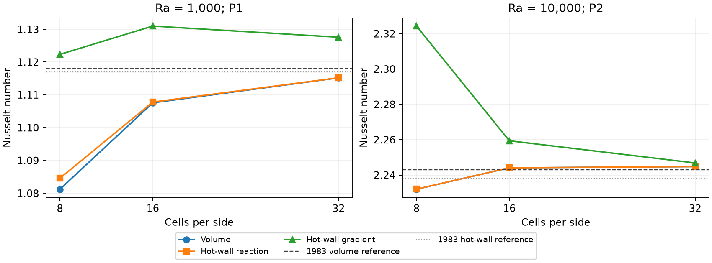

# B5 thermal Boussinesq verification and cavity checks

Date: 2 November 2026. Formulation: [B19–B24](../boussinesq_formulation.md).
Machine-readable measurements: [results JSON](boussinesq_b5_results.json).
These checks use Firedrake 2026.10.0, PETSc 3.26.0 and Python 3.14.4.
The final unit suite passed **934 tests with 1 known xfail in 475.47 s**;
the six refinement tests passed in 36.41 s. The xfail is the existing
near-inviscid nonlinear ASGS limitation.

## Discrete identities

`tests/unit/test_thermal_budgets.py` solves the 48 combinations of three scalar
convection forms, two supported momentum forms and eight VMS variants. Each run
includes temperature and a passive copy, a BDF1 start, and two BDF2 steps.
The tests compare actual history/work terms, not differences of energy samples.
They require absolute budget residuals below `2e-10` and kinetic–potential
normalized residuals below `1e-8`; the JSON records measured maxima.

Separate checks cover all four time schemes with P1/P2, dynamic ASGS/OSS,
nonzero reference temperature, prescribed boundary flux/source work, nonzero
Dirichlet reaction work, periodic variance with nonzero temperature subscales,
and rejection of inadmissible constant/potential tests. The higher-degree
diffusion cross term is explicitly nonzero in the P2 fixtures. A tetrahedral
3D coupled CN smoke test closes both energy and variance budgets.

The corrected exchange statement is essential. For example, the static linear
ASGS/conservative case has a nonzero linear exchange remainder about
`-2.377e-3`; it is included in the budget rather than asserted to vanish.
Matching linear OSS/conservative cases have negligible exchange remainder.
Nonlinear subscale, scalar-convection, reference and finite-iterate contributions
are reported separately. Projection work is measured rather than assumed zero.

The normalization is the signed residual divided by the sum of absolute work
and rate terms, with floor `1e-12`. Thermal metadata records the floor and solve
time convention. Dynamic ASGS uses cross storage, static ASGS uses mixed rates,
and nonzero Dirichlet variance includes variational reaction work. Content
checks require an admissible constant test; potential checks reject temperature
Dirichlet walls and periodicity along gravity. No closure was changed to enforce
a conservation hypothesis. Optional G5 proxy ratios remain unimplemented.

Measured maximum absolute residuals were `2.93e-11` for content, `6.39e-12`
for variance and `9.80e-12` for kinetic–potential energy. The latter's largest
normalized residual was `4.10e-9`. For near-zero content work, interpret the
normalized value alongside its absolute residual: the largest normalized
content value, about `1.05e-3`, occurs at the normalization floor and corresponds
to an absolute residual about `1.05e-15`, not a comparable error in total content.

## Spatial and temporal refinement

The spatial test uses the coupled manufactured solution, static linear OSS,
meshes 8×8, 16×16, 32×32, and a time-linear exact solution with BDF1. Rates below
are from the finest mesh pair, using the configured error quadrature.

| Degree | Velocity L2 | Velocity H1 seminorm | Pressure L2 | Temperature L2 | Temperature H1 seminorm |
| --- | ---: | ---: | ---: | ---: | ---: |
| P1 | 2.0044 | 1.0001 | 1.6706 | 2.0004 | 1.0000 |
| P2 | 3.0541 | 2.0159 | 2.6346 | 4.0339 | 2.9403 |

The bilinear exact temperature belongs to P2; its observed rate exceeds the
general target and is not a claim of fourth-order convergence for arbitrary
P2 temperatures. The prescribed target remains L2 order `k+1`, H1 order `k`.

The temporal test uses a periodic discrete shear eigenmode: temperature decays
and drives vertical velocity through buoyancy. This removes spatial error and
isolates the shared history operator and coupling. Its compatible OSS subscales
are zero. Time steps are 0.02, 0.01, 0.005 to `t=0.2`.

| Scheme | Velocity L2 order | Temperature L2 order |
| --- | ---: | ---: |
| BDF1 | 0.9806 | 0.9855 |
| BDF2 | 2.0138 | 2.0071 |
| BDF3 | 3.0294 | 3.0236 |
| Crank–Nicolson | 1.9666 | 1.9808 |

BDF tests use exact resolved negative-time histories. The CN run retains its
BDF1 start. These orders do not remove the documented startup limitation of
zero negative histories for an arbitrarily forced subscale ODE.

The conservative Galerkin test uses MUMPS null-pivot detection for the constant
pressure mode (`mat_mumps_icntl_24=1`), as exposed by
[PETSc's option definitions](https://petsc.org/main/src/mat/impls/aij/mpi/mumps/impl/imumps.c.html).
Without it, one coarse second-step factorization failed. The 4×4 temperature
error, approximately `4.43e-5`, also exceeds the older convection forms' fixed
coarse error threshold. Refining 4×4→8×8 reduces that error to `5.13e-6`, order
`3.109`. Its dedicated test checks the P2 target instead of changing the
formulation or weakening that older test.
The runnable conservative Galerkin example records the factorization option.

## Parallel agreement and compatibility

`tests/verification/boussinesq_mpi_probe.py` runs the same nonlinear dynamic OSS
heated-cavity problem on one and two MPI ranks. The largest absolute difference
among global thermal diagnostics was `1.4433e-15`. Two-rank velocity and thermal
orthogonality norms were `3.43e-18` and `5.33e-17`. Quantities use global PETSc
reductions and assembled integrals; no local-array sum is treated as global.

Four isothermal baselines and three previous thermal baselines retain bitwise
identical field arrays and diagnostic/inner/outer CSV records. No isothermal
default or budget definition is widened. Thermal energy uses its distinct
`boussinesq_energy_budget` group; thermal momentum budgets remain B6 work.

## Square cavity

The primary [de Vahl Davis benchmark, pp. 249–250 and Table V](https://elearning.univ-bejaia.dz/pluginfile.php/310888/mod_resource/content/0/Ref%20%5B4%5D.pdf)
specifies a unit square, no-slip walls, heated/cooled vertical sides, insulated
horizontal sides and `Pr=0.71`. Its scaling uses thermal diffusion. We use
free-fall units and center temperature at the wall mean, an equivalent steady
Boussinesq problem after a hydrostatic pressure shift. Our coefficients are
`nu=sqrt(Pr/Ra)`, `kappa=1/sqrt(Ra*Pr)`, unit coupling and downward unit gravity.
Table V distinguishes cavity-average Nu (`1.118`, `2.243`) from hot-wall Nu
(`1.117`, `2.238`) at the two Rayleigh numbers below. The source explains that
separate extrapolation leaves these derived quantities slightly inconsistent;
we compare each named quantity with its matching reference.

All runs use dynamic nonlinear OSS, skew scalar/momentum convection, BDF2,
`dt=0.2`, and `t_end=150`. Initial velocity is zero and temperature is the
linear conduction profile. The final 50 volume-Nu samples are unchanged at
output precision. Final angular momentum is negative in every run, confirming
clockwise circulation: warm fluid rises along the left wall.

| Ra | Degree | Cells per side | Volume Nu | Hot reaction Nu | Hot gradient Nu |
| --- | --- | ---: | ---: | ---: | ---: |
| 1,000 | P1 | 8 | 1.081217 | 1.084578 | 1.122329 |
| 1,000 | P1 | 16 | 1.107566 | 1.107794 | 1.130976 |
| 1,000 | P1 | 32 | 1.115182 | 1.115197 | 1.127569 |
| 10,000 | P2 | 8 | 2.231967 | 2.232015 | 2.324309 |
| 10,000 | P2 | 16 | 2.244099 | 2.244099 | 2.259387 |
| 10,000 | P2 | 32 | 2.244784 | 2.244784 | 2.246833 |

The JSON retains unrounded values, final wall imbalance and run paths. The fine
volume estimates differ from their primary references by about 0.25% and
0.08%; corresponding reaction estimates differ from the hot-wall references by
about 0.16% and 0.30%. Hot/cold reaction fluxes agree to solver precision. The
finite-mesh gradient estimate is visibly less accurate, especially for P1, and
must not be substituted for the variational reaction in a discrete heat balance.



Gradient flux means `-kappa grad(T)·n`. Reaction flux is minus the full weak
scalar residual on a boundary lifting. Shared Dirichlet nodes are partitioned,
avoiding double-counted corner reactions. Positive hot-wall Nu reverses the
outward-flux sign; positive cold-wall Nu follows it. These are intentionally
different measurements before the mesh limit.

## Tall-cavity integration checks

The author-posted [Christon, Gresho and Sutton reference, §2](https://www.researchgate.net/publication/247405116_Computational_Predictability_of_Time-dependent_Natural_Convection_Flows_in_Enclosures_Including_a_Benchmark_Solution)
defines width-based free-fall scaling, height/width eight, `Pr=0.71`, no-slip
walls, temperatures `+0.5/-0.5`, insulated horizontal walls, and permits an
initially isothermal stationary fluid. Its requested benchmark is at
`Ra=3.4e5`, distinct from Codina's `3.45e5`.

After the square-cavity checks, the three tall-cavity configs were run at
Codina's Rayleigh numbers. Each completed 20 BDF2 steps to `t=1.6` with `dt=0.08`
on a 16×128 triangular mesh. Final coupled residuals were `7.43e-14`, `9.25e-13`
and `7.65e-13` for Ra `3.45e5`, `1e6`, `1e7` respectively.

These are startup/integration checks. They use 4,096 triangles and 2,193
vertices, and the common same-scheme BDF2 subscales. The 2010 paper used 10,500
bilinear quadrilaterals, 10,721 nodes and BE subscales with BDF2 resolved fields.
Our short, coarser calculations establish neither resolved boundary layers nor
long-time oscillations, chaos or agreement with the published figures. Longer
mesh/time/initial-condition studies remain subsequent work. No KH application
or B6 option extension is included in B5.

## Reproduction

Use the project Firedrake environment and common cache locations. Tests:

```bash
python -m pytest tests/unit -n 2 -q
python -m pytest tests/verification/test_boussinesq_convergence.py -n 2 -q
python tests/verification/boussinesq_mpi_probe.py /tmp/b5_serial
mpiexec -n 2 python tests/verification/boussinesq_mpi_probe.py /tmp/b5_mpi
```

Run cavity examples exclusively through `scripts/run_simulation.py`, using
`configs/boussinesq/cavity_ra1000.toml`, `cavity_ra10000.toml` and the three
`codina_tall_ra*_smoke.toml` files. For the square refinement, set `mesh.cells`
to `[8,8]`, `[16,16]`, `[32,32]` with a fresh `run_name`; retain P1 for Ra 1,000
and P2 for Ra 10,000 and all other parameters above. Configurations resolved for
each measured run are stored beside its diagnostics. `run_simulation.py`
intentionally refuses an existing results directory.
