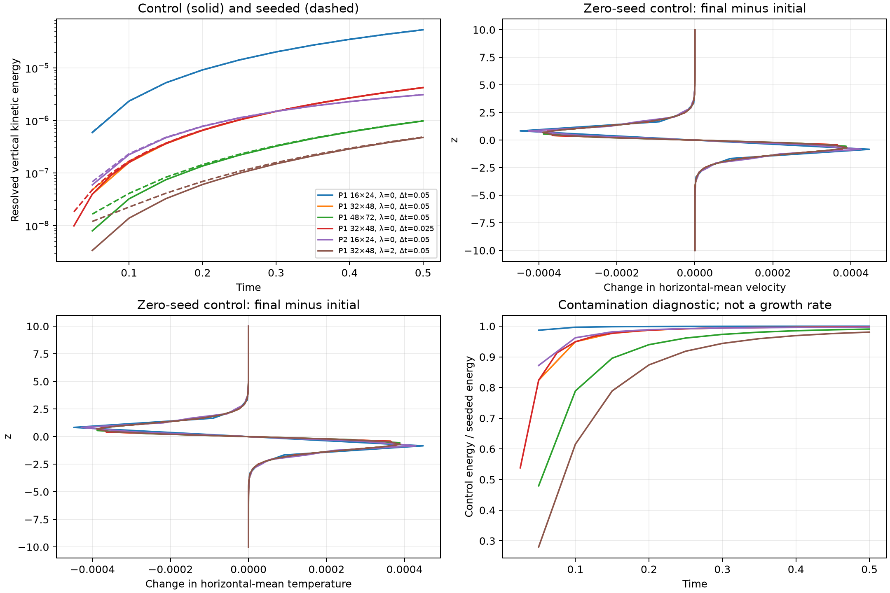

# B7.2 Kelvin–Helmholtz mesh and startup verification

Date: 3 November 2026. Scope:
[B7.2](../boussinesq_implementation_plan.md#b72--mesh-startup-and-reference-preparation).
Measured data: [paired runs](kelvin_helmholtz_b72_results.json),
[parallel/regression checks](kelvin_helmholtz_b72_checks.json).
Definitions: [case conventions](../../data/references/kelvin_helmholtz/README.md).

The mesh/startup checkpoint is complete. It adds checked vertex clustering,
horizontal-mean profiles and reproducible zero-seed/seeded comparisons. It
does **not** establish a usable KH growth-fitting window: zero-seed vertical
energy is 98–99.98% as large as the seeded energy at t=0.5 on these meshes.
Further reference-resolution and mode/control checks must precede a B7.3 fit.
The formulation, seed amplitude, subscale initialization and sources were not
altered to make this comparison look better.



## Mesh and interpolation

`clustering=0` retains uniform rows. Positive lambda applies the specified sinh
map to vertices before constructing spaces or assembling geometry. A stable
exponential/expm1 expression implements the same map and its uniform limit.
Rows must remain finite and strictly ordered, so the vertical map has positive
Jacobian. Clustered meshes are rejected if the outermost cell exceeds the flat
wall-buffer width: the complete boundary cell then lies in the plateau and
interpolation preserves the exact initial free-slip/insulated data.

Firedrake's reference triangle orientations are mixed. The geometry probe
observed both positive and negative raw determinants on a valid uniform mesh.
Quality therefore records absolute cell determinants and their ratio to the
uniform-cell determinant, alongside the ordered-row check. This measures the
positive Jacobian of the piecewise affine vertical map without confusing a
reference orientation with an inverted mesh. Aspect ratio means longest edge
over shortest altitude, `h_max²/(2 area)`; no arbitrary aspect-ratio cutoff is
used to alter a run.

| Mesh | Smallest edge | Map-Jacobian range | Largest aspect ratio |
| --- | ---: | ---: | ---: |
| Uniform 16×24 | 0.833333 | 1–1 (roundoff) | 2.00339 |
| Uniform 32×48 | 0.416667 | 1–1 (roundoff) | 2.00339 |
| Uniform 48×72 | 0.277778 | 1–1 (roundoff) | 2.00339 |
| lambda=2, 32×48 | 0.230033 | 0.552080–1.993650 | 2.44073 |

The clustered mesh retains affine cells. Unit tests check the zero/small-lambda
limit, reflection symmetry, collapse rejection, plateau resolution, actual
Jacobian/edge/aspect ranges and area. P1/P2 interpolation checks verify zero
normal velocity, zero tangential velocity derivative and zero T/q wall flux.
Dynamic velocity/scalar histories and every OSS projection start at zero.
Across the 12 runs, initial normal flow is exactly zero at output precision;
the largest scalar wall-flux norm is the P2 temperature roundoff value 2.581e-18.
The original uniform path still permits very coarse meshes and reports their
initial compatibility; the stricter plateau condition applies to newly enabled
positive clustering.

## Horizontal means and output lifecycle

Opt-in `output.horizontal_profiles_every` uses the optional
`HorizontalProfileGeometry` problem data. On each mesh row and midrow, the line
intersects triangle boundaries at horizontal cell endpoints/midpoints. Splitting
each horizontal cell into halves lets Gauss quadrature integrate the FE trace
exactly: two points per half-cell for CG1/CG2, more where needed for higher degree.
The rule is separate postprocessing and changes no residual, volume quadrature
or OSS projection. Collective `PointEvaluator` calls return globally ordered
point data before the weighted mean is taken.

CSV names velocity components, temperature and each tracer. It includes t=0,
interval steps and the final/early-stop endpoint. Disabled output writes no
profile files and omits the new default option from old resolved-config output.
Tests cover option/geometry validation, unsupported-case rejection, config
round trips, early stopping and file lifecycle. Random CG1/CG2/CG4 fields on
uniform and clustered meshes agree with independent five-point overintegration
within 2e-13. The independent check samples the actual FE field, not just an
analytic function of height or a single centreline.

Analysis reports the maximum, over sampled heights, of each current mean minus
its own interpolated initial mean. These are sampled profile changes, not a
volume L2 error or a claim of a steady tanh reference.

## Matched startup studies

Six pairs use epsilon=0 and 1e-4 at Re=1000, Pr=Sc=1, Ri=0.1. All use dynamic
nonlinear OSS, BDF2 with lower-order startup and default skew-symmetric
convection, ending at t=0.5. The clustered pair includes passive moisture;
other pairs are dry. No force maintains the base. Initial pressure comes from
the same analytic primitive and is interpolated/mean normalized as in B7.1.

| Setup | Initial pressure–buoyancy L2 defect | Control E_w at t=0.5 | Seeded E_w at t=0.5 | Control/seeded |
| --- | ---: | ---: | ---: | ---: |
| P1 16×24, dt=0.05 | 0.104368 | 5.33868e-5 | 5.33951e-5 | 0.999844 |
| P1 32×48, dt=0.05 | 0.0522099 | 4.22771e-6 | 4.23685e-6 | 0.997844 |
| P1 48×72, dt=0.05 | 0.0348079 | 9.81507e-7 | 9.90802e-7 | 0.990619 |
| P1 32×48, dt=0.025 | 0.0522099 | 4.23988e-6 | 4.24901e-6 | 0.997851 |
| P2 16×24, dt=0.05 | 0.0100547 | 3.10483e-6 | 3.11424e-6 | 0.996977 |
| P1 32×48, lambda=2, dt=0.05 | 0.0294135 | 4.76667e-7 | 4.85992e-7 | 0.980811 |

The uniform P1 initialization defect decreases approximately linearly with
vertical spacing. Control energy also decreases with refinement, and halving
dt changes the medium-mesh final control energy by about 0.288%; it does not
remove the contamination. Clustering reduces it but does not make this tiny
seed dominant. The P2 half-cell-count comparison is a measured comparison,
not an accuracy-equivalence claim.

For each zero-seed control, the maximum sampled horizontal-mean velocity change
at t=0.5 is 3.78e-4–4.48e-4; temperature changes are of similar size. The means
therefore evolve, as an unforced viscous/diffusive base should. The wet clustered
seeded run also records moisture-profile change (maximum 4.357e-4). These are
short startup observations, not a long-time base-drift validation. Maximum
sampled degree-weighted advective CFL across the study is below 0.181.
All coupled energy-budget residuals remain below 1.7e-13 in absolute value,
including the existing exchange/iterate defects and actual discrete histories.

The continuum zero-seed state has horizontal shear and temperature depending
only on height; viscosity/diffusivity evolve them, with pressure balancing the
vertical buoyancy force. The nonzero computed vertical motion is a discrete
hydrostatic/startup effect. The initial pressure is just a nonlinear-solve guess:
a separate control test replaces it with zero and obtains the same converged
velocity, temperature and mean-normalized pressure within 1e-10. Thus changing
only that guess cannot repair the measured motion. No holding force, pressure
reformulation, modified closure or larger seed was introduced.

The two energies are kept separately. Their difference is **not** the energy
of the difference velocity; a raw-energy logarithmic slope would mix startup
and seeded motion. No rate is fitted, no inviscid reference is enforced, and
the proposed 128×192 production mesh is not certified by these lower-cost runs.
B7.3 must establish a resolved seeded-mode/control comparison and a suitable
window before reporting instability growth.

## Parallel, regression and reproduction

The wet clustered seeded run also completed on two MPI ranks. Profile means
agree with serial below 4.45e-16, recorded heights/times agree exactly and
generated noise phases match. The largest unnormalized diagnostic difference
is 5.116e-13; the energy budget's normalized-residual difference is below
9.24e-13. The local MPI test needed sockets outside the sandbox and received
automatic approval.

The unit regression run passed **1,056 tests with one existing xfail in 476.92 s**.
The known near-inviscid nonlinear ASGS xfail is unchanged. This run includes
the first 28 new startup checks. The final focused run passed **43 tests in
8.45 s**, adding pressure-guess/column-conflict checks and 12 analysis checks.
Analysis validation/provenance edits were also rechecked (12 passed).
The analysis tests reject incomplete runs, missing/mismatched profiles, negative
or nonfinite data and unmatched physical/numerical pairs. Four isothermal and
three prior thermal baselines retain bitwise-identical field arrays and
diagnostic/inner/outer CSV plus initial/thermal JSON records against `f7da5a0`;
wall-clock timings are excluded. Lint, formatting, TOML/JSON parsing, local
links, math fences and report/data consistency passed.

All integrations use the existing entry point. With fresh result folders:

```bash
for config in configs/boussinesq/kh_startup{,_uniform_medium,_uniform_fine,_half_dt,_p2,_clustered}_{control,seeded}.toml; do
  python scripts/run_simulation.py "$config"
done
python scripts/analyse_kh_startup.py \
  results/kelvin_helmholtz_shear_layer/b72_{startup,uniform_medium,uniform_fine,half_dt,p2,clustered}_{control,seeded} \
  --output /tmp/kh_startup.json --figure /tmp/kh_startup.png
```

The analysis command reads completed files only; it runs no solver. Logs are
`/tmp/vms-b72-all.log`, `/tmp/vms-b72-final-review.log`,
`/tmp/vms-b72-analysis-tests.log`, `/tmp/vms-b72-clustered-mpi.log` and
`/tmp/vms-b72-kh_startup_*.log`. Canonical base logs are
`/tmp/vms-b72-{control,seeded}.log`. Regression artifacts are
`/tmp/vms-b72-{before,after}-{isothermal,thermal}`.

B7.2 ends here. B6 compatibility, KH rate fitting, billows, cloud diagnostics
and optional physical feedback remain later work.
