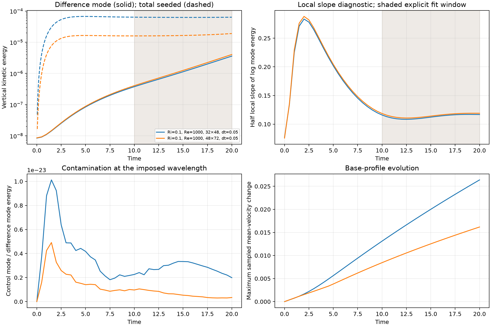

# B7.3 bounded Fourier-growth pilot

Date: 3 November 2026. Scope: the owner selected the bounded pilot and
refinement assessment before the expensive reference study. B7.3 as a whole
remains in progress; the dry/cloud phases remain pending.

**Outcome:** the imposed Fourier mode can be isolated from startup motion and
is growing on both pilot meshes. The two fitted modal rates differ by 1.73%,
but half-window rates drift by 5.1–5.6%, base-profile evolution remains
resolution-sensitive, and total vertical energy is still dominated by other
motion. This is not yet a validated asymptotic growth rate or a passed B7.3 gate.

Measurements: [paired results](kelvin_helmholtz_b73_results.json),
[window sensitivity and implementation checks](kelvin_helmholtz_b73_checks.json).



## Measurement

The profile writer optionally records horizontal sine/cosine coefficients for
velocity, temperature and every passive scalar. All sampling is collective,
at endpoint states, on the structured affine channel's rows and midrows.
For each component the coefficients are horizontal averages, not doubled
amplitudes. For vertical velocity, the mode energy is

$$
E_m=L_x\int(C_m^2+S_m^2)\,dz.
$$

The matched perturbation energy uses coefficient differences before squaring.
It is neither the difference of two total energies nor an assertion that the
entire difference field is in that mode. The imposed single wave is index 1;
index 2 monitors the second harmonic. The mean and both real Fourier parts
are kept, including t=0. The horizontal product with trigonometric weights is
overintegrated with eight Gauss points per half-cell at P1/P2; composite Simpson
integration uses the actual vertical cell widths and midpoint values. These
are approximations whose resolution sensitivity must be measured.

`analyse_kh_growth.py` reuses the strict completed-run and matched-setup checks
from the startup analysis. It exports total, seeded-mode, control-mode and
coefficient-difference energies separately. An explicit fit window is required
to fit any rates. Reports retain logarithmic residuals, half-window rates,
OLS slope uncertainty, endpoint shape coherence, second-harmonic content and
sampled mean-profile drift. OLS uncertainty describes fit residuals only.
No formula, source, seed amplitude or subscale initialization was changed.

## Runs and cost

The bounded study uses Ri=0.1, Re=1000, Pr=Sc=1, epsilon=0/1e-4, no noise or
moisture, uniform P1 triangles, dynamic nonlinear OSS and BDF2 with its BDF1
startup. dt=0.05, t_end=20; profiles are written every 10 steps (0.5 time units).
Two matched pairs use 32×48 and 48×72 cells, a 1.5× refinement in both directions.
Convection and solver tolerances retain the project defaults.

The separate 128×192 timing run completed three steps to t=0.15 in 95.68 s.
Steps 2 and 3 each took approximately 30–31 s while other pilots/tests were
active. Extrapolating that early cost gives roughly 3.4 hours for one 400-step
reference run at the observed load, before allowing for changing iterations.
The refined and half-dt runs add substantial work; their costs have not been
measured. This is an estimate, not a performance guarantee.

The 36 prepared inputs under `configs/boussinesq/kh_growth/` span Ri=0/0.1/0.3,
Re=1000/2000, 128×192 reference / 192×288 refinement / dt=0.025 at the reference
mesh, each with a zero-seed/seeded pair. They use t_end=20 as a proposed pilot
horizon, not a certified fitting window for all parameters. **They have not
been launched.** The stabilization-spread study is also pending. The owner's
budget choice keeps this checkpoint to the bounded pilot and assessment.

## Results

All four runs completed 400 steps successfully, with physical profiles and
Fourier samples at t=0, 0.5, ..., 20. No run was stopped early or omitted.

| Mesh | Modal sigma, t=10–20 | Half-window sigmas | RMS log-energy residual | Total-energy sigma, t=10–20 |
| --- | ---: | --- | ---: | ---: |
| 32×48 | 0.112618 | 0.109625 / 0.115955 | 0.009942 | −0.000241 |
| 48×72 | 0.114598 | 0.111905 / 0.117807 | 0.009422 | 0.008108 |

The modal fits use coefficient differences, with 21 samples in the window.
Their OLS standard errors are 0.000377 and 0.000357, respectively. The relative
mesh difference, normalized by the finer modal rate, is 1.73%. However, the
half-window changes are 5.62% and 5.15% of the respective full-window rates,
larger than that mesh difference. The 10–15 and 15–20 sensitivity fits are kept
in the checks JSON, along with the strongly transient early windows. The
window has not been selected to match an inviscid or stratified reference.

Control energy at the imposed mode is below 1.1e-23 of the coefficient-difference
mode energy at every recorded time on both meshes. This is consistent with the
strong streamwise symmetry of these controls, and separates the imposed wave
from the large startup contribution in other modes. At t=20, the seeded mode
accounts for only 5.67% / 21.29% of the total seeded vertical kinetic energy on
the coarse/finer mesh. The total-energy fits in the table consequently give a
different answer and cannot be labelled the KH eigenmode rate.

The perturbation's largest sampled mode-1 vertical-velocity amplitude is
0.000483 / 0.000503. At t=20, its second-harmonic energy divided by mode-1
energy is 4.57e-7 / 4.47e-7. Phase-independent endpoint shape coherence over
t=10–20 is 0.999021 / 0.999034. These observations support a small, coherent
growing component; they do not eliminate the measured slope drift.

The maximum sampled horizontal-mean velocity change at t=20 is 0.026385 /
0.016178; temperature changes are 0.026387 / 0.016180. This includes physical
diffusion and numerical evolution. Its sensitivity to resolution prevents
treating a 1.73% rate difference alone as a full convergence certificate.
The maximum sampled CFL in the seeded runs is 0.120006 / 0.180009, and their
largest absolute coupled energy-budget residual is 7.65e-14 / 6.53e-14.

The coarse control/seeded runs took 696 / 704 s; the finer pair took
1,164 / 1,295 s. These are observed wall times with concurrent runs and tests,
not isolated throughput benchmarks. The full reference matrix and all other
Ri/Re values, timestep sensitivity and stabilization spread remain unmeasured.

**Next gate:** check a later interval and timestep sensitivity, monitor the
evolving base, then confirm spatial sensitivity on an additional mesh. Do not
launch the full physical matrix or claim readiness for the cloud case from
this pilot alone. The original total-energy growth requirement remains unmet;
the isolated modal slopes above are explicitly preliminary diagnostics.

## Reproduction

```bash
python scripts/run_simulation.py configs/boussinesq/kh_growth_coarse_control.toml
python scripts/run_simulation.py configs/boussinesq/kh_growth_coarse_seeded.toml
python scripts/run_simulation.py configs/boussinesq/kh_growth_pilot_control.toml
python scripts/run_simulation.py configs/boussinesq/kh_growth_pilot_seeded.toml
python scripts/analyse_kh_growth.py \
  results/kelvin_helmholtz_shear_layer/b73_coarse_control \
  results/kelvin_helmholtz_shear_layer/b73_coarse_seeded \
  results/kelvin_helmholtz_shear_layer/b73_pilot_control \
  results/kelvin_helmholtz_shear_layer/b73_pilot_seeded \
  --window 10 20 --output /tmp/kh_growth.json --figure /tmp/kh_growth.png
```

The solver refuses to overwrite an existing result folder. Recorded JSON
measurements retain run provenance. The analysis-only command requires the
completed output, not just the configs. Repeat the analysis with windows
10–15 and 15–20 to expose transient drift rather than selecting a window to
match an expected rate.

## Implementation checks

The new Fourier profile test uses the exact Fourier attenuation of a periodic
piecewise-linear FE interpolant of sine/cosine, so it checks sign and
normalization independently. The growth test uses prescribed exponential
coefficients with a nonzero matched control, for which subtracting energies
would give the wrong answer. A curved signal verifies the half-window drift
measurement and invalid windows are rejected.

Serial/two-rank output agrees within 4.45e-16 across all profile columns in
the two-step check. Seven prior flow/thermal baselines retain identical field
arrays and CSV/JSON records across 46 files against `ebdef44`, excluding the
wall-time column. The full retained unit suite passed with **1,016 passed and
one existing expected Gresho failure** in 905.36 s. The final analysis-specific
checks passed all 14 cases. All 1,086 tests collect; the unchanged slow
verification studies were not rerun for this postprocessing change.

Ruff lint/format, `git diff --check`, config round trips, measured JSON consistency
and local documentation links passed. The scientific plot was inspected.
