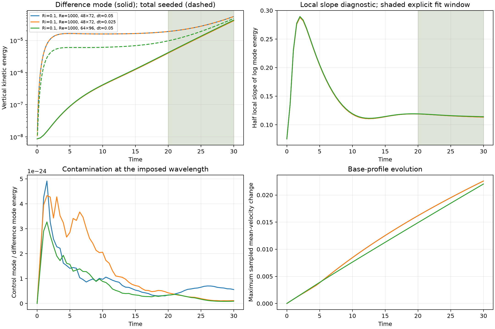

# B7.3 later-window and refinement assessment

Scope: continue the owner-selected bounded study at Ri=0.1, Re=1000,
Pr=Sc=1, epsilon=0/1e-4, with no moisture or noise. The original
[t=20 pilot](kelvin_helmholtz_b73.md) remains a separate historical checkpoint.

**Outcome:** the primary-window modal rate changes by 0.38% with the additional
mesh and 0.0010% with the half timestep. Its half-window drift remains
2.45–2.73%, just above the proposed 2% target. The predeclared 25–30 interval
has smaller drift and gives a useful **local, window-conditioned** growth rate.
It does not establish a unique asymptotic eigenvalue or complete the full B7.3
physical/stabilization matrix. No cloud simulation was launched.

[Paired measurements](kelvin_helmholtz_b73_refinement_results.json),
[sensitivity and execution checks](kelvin_helmholtz_b73_refinement_checks.json),
[independent control reference](kelvin_helmholtz_b73_refinement_base.json).



## Planned comparisons

| Pair | Cells | dt | End time | Purpose |
| --- | --- | --- | --- | --- |
| `b73_late_*` | 48×72 | 0.05 | 30 | Later interval at the prior finer resolution |
| `b73_late_half_dt_*` | 48×72 | 0.025 | 30 | Timestep sensitivity |
| `b73_late_finer_*` | 64×96 | 0.05 | 30 | One additional intermediate mesh |

The 64×96 mesh is a 4/3 refinement of 48×72 in each direction, not the full
study's proposed 128×192 reference mesh. The three-step 64×96 probe took
24.85 s serial, with later solve steps taking about 6 s at the observed load.
A two-rank probe took 22.15 s and agrees in sampled profiles within 1.56e-15;
the gain was modest, so the six study runs retain serial execution.

All pairs retain dynamic nonlinear OSS, BDF2 with BDF1 startup, default
convection and solver tolerances, and zero subscale/projection initialization.
Profiles and Fourier modes 1 and 2 are recorded every 0.5 time units at both
timesteps. Runs start at t=0 because this framework does not save a restart
state. Their common prefixes can be compared with the previous t=20 runs.

The primary fitting interval is **20–30**, selected before examining its
results. Report secondary intervals **15–25**, **20–25**, and **25–30** as well
as the common **10–20** interval. Keep fitted rates and residuals, half-window
drift, control contamination, endpoint mode-shape overlap, harmonic content,
perturbation amplitude and sampled base-profile drift. Do not shorten a window
to match an expected reference rate.

Use 2% as the proposed relative sensitivity target for the clearly positive
modal rate when comparing mesh, timestep and half-window fits. OLS uncertainty
is only a fit diagnostic. Passing these checks for one isolated mode does not
override the original total-energy criterion or validate the remaining Ri/Re
and stabilization matrix. All full-study configs remain unlaunched.

## Measurements

All six runs completed successfully: 600 steps per original-timestep run and
1,200 per half-timestep run, totaling **4,800 converged steps**. The common
0.5-time-unit Fourier output gives 21 samples in the main window.

| Cells | dt | Modal sigma, 20–30 | Half-window relative drift | RMS log-energy residual | Total-energy sigma, 20–30 |
| --- | ---: | ---: | ---: | ---: | ---: |
| 48×72 | 0.05 | 0.115833 | 2.73% | 0.004874 | 0.053700 |
| 48×72 | 0.025 | 0.115831 | 2.73% | 0.004872 | 0.053697 |
| 64×96 | 0.05 | 0.116272 | 2.45% | 0.004400 | 0.081035 |

Normalize the mesh difference by the 64×96 rate and the timestep difference
by the dt=0.025 rate. The resulting differences are **0.3779%** and **0.001031%**.
These satisfy the proposed sensitivity target for this observable and setup.
The primary window's drift does not, so the combined primary-window target
remains false in the checks JSON. OLS slope errors are approximately
0.000185, 0.000185 and 0.000167, measuring residual curvature rather than the
complete numerical or window-selection uncertainty.

The additional windows were specified before their results were examined:

| Interval | 48×72, dt=0.05 | 48×72, dt=0.025 | 64×96, dt=0.05 |
| --- | ---: | ---: | ---: |
| 15–25 | 0.117989 | 0.117989 | 0.118258 |
| 20–25 | 0.117390 | 0.117389 | 0.117690 |
| 25–30 | 0.114410 | 0.114410 | 0.115004 |

In 25–30, the mesh difference is 0.516% and the timestep difference is
0.000554%. Half-window drift is 1.08%, 1.08% and 0.90%, respectively.
All three local sensitivity targets hold in that predeclared secondary window.
However, moving the window still changes the inferred rate; report its interval
alongside the rate. A longer integration alone has not removed this dependence.

At t=30, the imposed mode accounts for 73.83%, 73.83% and 88.76% of total
resolved vertical energy. The total-energy slopes in the main table remain
different from the modal slopes; the original unfiltered-energy criterion is
not silently declared satisfied. Control-mode energy stays below 5e-24 of
the coefficient-difference mode energy. Endpoint shape coherence in 20–30 is
above 0.999938. Maximum sampled modal vertical-velocity amplitude is below
0.00163; final second-harmonic energy ratios are below 4.60e-6. These are
small, coherent perturbations, not nonlinear billows or clouds.

The largest absolute coupled budget residual across the study is below
9.36e-14. Thermal content stays within 7e-12 of zero. Seeded maximum CFL is
0.180042, 0.090021 and 0.240058. Changing the vertical energy integration from
Simpson to trapezoids changes the fitted rate by less than 0.000116%; this is
a quadrature-sensitivity indicator, not a rigorous error bound.

## Independent control-profile check

The continuous zero-seed solution admits
$u=(U(z,t),0)$, $U_t=\nu U_{zz}$, $\theta_t=\kappa\theta_{zz}$,
$p_z=Ri\theta$, with insulated/free-slip walls. Here $\nu=\kappa$ and the
initial horizontal velocity and temperature coincide, so their exact diffusion
profiles coincide. This reference supplies no force and changes no simulated
initialization. It isolates evolution from each control's actual piecewise-linear
FE initial profile, rather than mixing in the initial interpolation error.

For height $2H$, odd initial data admit the Neumann sine expansion

$$
k_n=(n+\tfrac12)\pi/H,\qquad
U(z,t)=\sum_{n\ge0} a_n e^{-\nu k_n^2t}\sin(k_nz).
$$

If the initial profile has slopes $m_j$ between vertices $z_j$, its coefficients
are obtained exactly by integrating each linear segment:

$$
a_n=\frac{1}{Hk_n^2}\sum_j m_j
       [\sin(k_nz_{j+1})-\sin(k_nz_j)].
$$

The calculation uses 512 modes. At the measured times 10, 15, 20, 25 and 30,
256 and 512 modes give identical values at stored double precision. Independent
32-point Gaussian integration per cell checks selected coefficients within
1e-15. The reference JSON records these checks and errors for both fields.

At t=30, maximum error in the control's sampled horizontal mean, over rows and
midrows, is **0.007038** on 48×72 and **0.003786** on 64×96. Halving dt leaves
the 48×72 error unchanged to about 2e-8. These are below 0.71% / 0.38% of the
unit velocity/thermal scales and decrease substantially with spatial refinement.
Thus the base evolution includes both physical diffusion and a measurable
spatial/model contribution. It should not all be attributed to physical drift.

For an additional discrete comparison, a plain 1D P1 Galerkin diffusion solve
uses the same vertices and timestep, with element mass
$h\begin{bmatrix}2&1\\1&2\end{bmatrix}/6$, stiffness
$\nu\begin{bmatrix}1&-1\\-1&1\end{bmatrix}/h$, BDF1 startup and then BDF2.
Its nodal difference from the coupled VMS control at t=30 is 0.008447 / 0.004243
on the two meshes. The coupled finite-mesh VMS problem is not required to
coincide with this unstabilized reference. This comparison is diagnostic;
maximum errors at different locations cannot be added as an error decomposition.

## Scope and next decision

The spatial and timestep checks support a useful finite-window modal rate for
this specific Ri/Re setup. The remaining window dependence persists after
those refinements and accompanies an evolving base state. Do not report a
window-independent asymptotic growth constant from these data. The full Ri/Re,
reference-mesh and stabilization-spread matrix remains unlaunched under the
owner's bounded budget. Dry nonlinear billows and cloud diagnostics remain
separate application stages.

## Reproduction and verification

Run each of the six `configs/boussinesq/kh_growth_late*.toml` inputs through
`scripts/run_simulation.py`, then:

```bash
python scripts/analyse_kh_growth.py \
  results/kelvin_helmholtz_shear_layer/b73_late_control \
  results/kelvin_helmholtz_shear_layer/b73_late_seeded \
  results/kelvin_helmholtz_shear_layer/b73_late_half_dt_control \
  results/kelvin_helmholtz_shear_layer/b73_late_half_dt_seeded \
  results/kelvin_helmholtz_shear_layer/b73_late_finer_control \
  results/kelvin_helmholtz_shear_layer/b73_late_finer_seeded \
  --window 20 30 --output /tmp/kh_late.json --figure /tmp/kh_late.png
```

Repeat with the secondary windows for their sensitivity tables. The simulated
fields, coefficients, seed and tolerances were not adjusted to obtain these
rates. The solver still refuses to overwrite existing results.

All seven new configs round-trip through the production loader. The two
longer 48×72 runs have bitwise-identical t<=20 diagnostics, iteration records,
time-step records and Fourier profiles against the previous pilot, excluding
wall-time columns. The scientific plot was inspected. Source, scripts and tests
are unchanged, so the unit suite was not repeated for this configuration/data
checkpoint. The prior source revision is `2f8810f`.

Observed control/seeded wall times were 1,717 / 2,079 s for the original-timestep
pair, 2,916 / 2,954 s for the half-timestep pair, and 3,001 / 3,313 s for the finer
pair. These runs overlapped; the numbers are not isolated performance timings
and must not be summed to obtain batch wall time.
